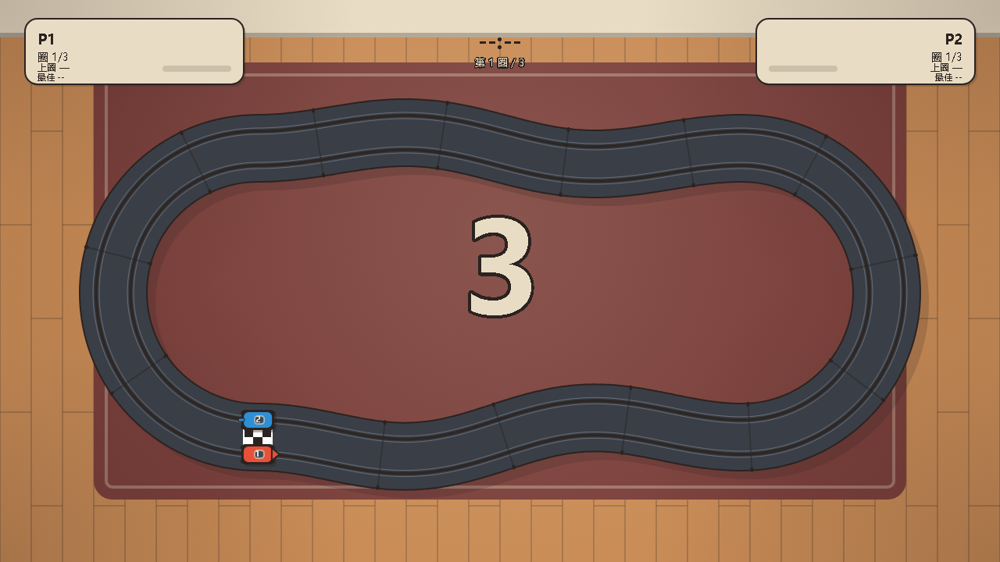

# 轨道赛车 · 双人成行阁楼小游戏（程序化复刻）

浏览器里双人同屏的微缩槽车竞速：复刻《双人成行》阁楼章节 Slotcars 的玩法——车沿槽自动行驶，只控油门，弯道不收油会脱轨。内置两条赛道（8 字环道 / 阁楼复刻），标题界面 ←/→ 切换。赛道与车辆用 WebGL 绘制（Three.js r149，已 vendor 到 `vendor/three.min.js`），HUD 是 Canvas 2D 叠加层；无素材文件、无构建步骤。



## 运行

- 双击 `index.html` 即可，`file://` 协议可直接运行，无需服务器。
- 建议 Chrome / Edge（使用 WebGL + Canvas 2D HUD 叠加层、WebAudio、localStorage）。
- 窗口任意大小：画面固定 1280×720 逻辑分辨率，按 16:9 letterbox 自适应居中，DPR 上限 2。
- 可选：`index.html?selftest=1` 跑自检，`index.html?demo=1` 跳过标题直接开赛，`index.html?track=attic` 指定赛道（写入 localStorage 记忆）。

## 操作

| 操作 | 按键 |
| --- | --- |
| P1 油门 | `W` 或 `空格` |
| P2 油门 | `↑` / `Enter` / 右 `Shift` |
| 暂停 / 继续 | `P` |
| 静音 / 取消静音 | `M` |
| 重开 | `R` |
| 切换赛道 | 标题界面 `←` / `→` |
| 屏上按钮 | 比赛中右上 ⏸ 暂停 / ♪ 静音；暂停面板 继续·重开·回标题；结算页 再来一局·回标题（触屏可用） |
| 开始 / 结算后再来一局 | `Enter` |

空格与方向键会阻止页面滚动；窗口失焦或标签页隐藏时自动清空按键，避免油门卡住。

油门有 0.3s 行程（点按≈半油门）；打滑时松油门可救车（HUD 显示“松油可救”），脱轨后按 飞出（硬护栏 `FLY_GUARD` 1.70s，软超时 2.2s / 硬截止 2.8s）→ 落地停留 0.35s → 归位 0.4s 的流程自动回槽，实测全程 1.54–2.30s。

## 移动端

- 手机/平板横屏打开 `index.html` 即可玩：**屏幕左半边 = P1 油门，右半边 = P2 油门**，按住加速、松开收油；两根手指可以同时按住左右两半。
- 标题界面**点按任意处开始**；点标题卡上的 `◀` / `▶`（或选择器整行左右半边）切换赛道。
- 竖屏时会盖一层「建议横屏游玩」的半透明提示，不阻断游戏，转屏后自动消失（画布随 `resize` 重算 letterbox）。
- 已做：`viewport` 禁缩放、`touch-action: none` 禁滚动/双击放大、`pointer` 事件按 `pointerId` 跟踪多指、失焦或切后台自动松开油门；键盘操作不受影响。
- 桌面端鼠标按住画面同样会给对应半边油门（方便无触屏设备调试），P2 没有鼠标键。
- 本地手机联调：在仓库根目录 `npx serve .`（或 `python -m http.server`），手机与电脑同一 Wi-Fi，访问 `http://<电脑局域网 IP>:3000/`。

## 规则

- 两辆车分居左右两条槽，3 圈定胜负，先跑完者获胜。标题界面 ←/→ 选择赛道（localStorage 记忆，`?track=` 可指定）。
- **8 字环道**（默认）：双纽线 8 字赛道，中央立体交叉，一段抬高 36px 的桥面、桥下净高 32px，上坡 12°、下坡 9.6°；起点在右侧平地段。弯道外侧有红白路肩与护栏。
- **阁楼复刻**：对照《双人成行》阁楼章节的实物赛道逆向——西侧 S 弯（带封闭环岛）、H2 发卡、中央高架桥面（车从桥面正下方穿过）、kink + chicane 双 S、东侧大环。总长 3689px（8 字的 1.45 倍），引桥坡长 280px（桥下净空充裕）。弯道最紧 r47（瞬时过渡点），持续弯半径 ≥53；全油门会连续脱轨——技术赛道，收油过弯是设计意图。起跑线为双白线样式（对照参考图）。
  几何约束：地面段之间中心线最近距离 ≥100px（路面宽 84px，即路基之间至少留 16px）；更近的几处（32–83px）全部是「桥面压在地面段上方」的穿越段，靠 36px 高差分开，不存在同高度压盖。赛道包围盒 888×566，与固定机位取景匹配。
- 车沿槽自动前进，唯一操作是油门；不需要也不能转向。
- 弯道速度超过抓地上限会真的甩出槽：飞行段由 cannon.js 刚体模拟（撞矮护栏、可越过护栏落到路肩、不穿桥面），约 0.35s 停顿后在 0.4s 里从空中放回槽心，并损失速度。实测全程 1.54–2.30s。
- HUD：双方圈数、速度条、油门量条、抓地条（黄=接近极限、红=超限）、上一圈用时、本场/存档最佳圈；中上显示总计时与当前圈。
- 结算：胜者名、双方总时间与最佳圈；每位玩家的分圈时间记录在 `lapTimes` 中，但界面未逐圈展开。
- 最佳圈为整数毫秒，写入 `localStorage`，键名 `slotrace.best`；仅记录本场冠军的最佳圈。

## 物理模型（给想改参数的人）

参数集中在 `js/car.js` 顶部、`js/track.js` 顶部与 `js/flight-physics.js` 顶部：抓地上限 `GRIP = 950`、脱轨偏移 `DERAIL_OFFSET = 10` px、三段时序 飞出 `FLIGHT_TIME = 2.2`（实际由 `FLY_GUARD = 1.70` 截断）+ 落地停留 `REST_TIME = 0.35` + 归位 `RETURN_TIME = 0.4`（`DERAIL_TIME = 2.95` 只是上限和）；飞行物理常量见 `js/flight-physics.js` 顶部（`MAX_FLIGHT_TIME = 2.2`、`HARD_STOP_TIME = 2.8`、矮护栏 `WALL_HEIGHT = 7`、`SPIN_RAMP = 0.15`、接触 摩擦 0.16 / 弹性 0.3）。

- 向心需求 `a_req = v² · |κ|`，曲率 `κ` 由中心线前后各 6px 的三点外接圆求得（带符号）。
- `a_req ≤ GRIP` 时导向销把车约束在槽内：侧滑速度按 8/s 衰减，偏移随之回落。
- `a_req > GRIP` 时抓地不足：侧滑速度按超出量（`a_req − GRIP`）累积，同时轮胎摩擦以 `0.25 × 超出量` 拖慢车速。
- 脱轨判据：`侧滑速度 / 车速 > 0.35`，或偏移 `> 10px`——导向销被拽出槽，车即甩出赛道。
- 松油可救：速度降下来后 `a_req` 回落，侧滑速度衰减，车被导向销拉回槽心。
- 脱轨瞬间车速清零、交给飞行刚体：横向初速取 `max(|侧滑速度|, 0.28×车速)` 并夹在 `0.5×车速` 以内，方向是弯道外法线 `(ty, −tx) × side`；竖直初速 `180 + 0.22×车速`；自旋 `1.6 + 0.01×车速`、0.15s 渐入，线阻尼 0.12 / 角阻尼 0.35。
- 起跳点按“距中心线的有符号横向坐标”夹到 `±31.5`（= 护栏内壁 45 − 车半宽 13 − 余量 0.5），起跳高度抬到矮护栏顶以上（车体底部在路面上 9px，护栏 7px）——外槽脱轨不会一出生就贴着护栏被侧面接触吃掉横向速度。
- 飞行段每辆车有独立的 cannon.js 世界：无限地面平面 + 桥面/引桥承力板（每 20px 一块、随坡度倾斜）+ 绕整圈两侧的矮护栏墙（高 7、厚 3、每 40px 一段），静态体只建一次、跨脱轨复用。
- 停稳判定：与任意支撑面（地面/桥面）接触且总速 < 40px/s 持续 0.25s，或 `elapsed > 2.2s` 且已落地（软超时后水平速度按 `exp(−6dt)` 强衰减），`elapsed > 2.8s` 硬截止——不会冻在半空。
- 归位段走世界坐标插值：目标比起点高 > 20px 时用“升到槽上方 16px → 平移 → 落下”三段，避免斜穿桥面/护栏；小落差走 smoothstep + 18px 小拱。
- 归位目标若落在桥面正下方的遮挡死角（`slotUnderDeck`），会沿赛道向后以 12px 步退最多 960px 退出遮挡区，避免“回到桥下就看不见”。
- 复位后偏移清零、速度重置为 120 px/s、材质半透明闪烁 0.18s。
- 调试参数：`index.html?throw=0.3~2.0` 缩放水平甩出力度（默认 1，竖直分量不缩放）；`?ff=秒数&freeze=1` 快进并冻结画面便于截帧；`?selftest=1` 离屏自检。
- 油门在物理层是 `0..1` 的连续量（`car.js` / `race.js` 按模拟量处理）：踩下以 3.34/s 上升（约 0.3s 踩满），松开以 8.33/s 回落（约 0.12s 松空）；键盘输入本身只产生 0 或 1，点按即约半油门。
- 加速度 `620 · throttle · (1 − v/400)`；油门 ≤ 0.02 时按 240 px/s² 减速（救车窗口内 480 px/s²）；最高速度 400 px/s。
- 坡度影响纵向加速度：`accel −= 600 × slope`（上坡 slope > 0 减速，下坡 slope < 0 加速）。
- 赛道：双纽线 `x = 405·sin t`、`y = 215·sin 2t`，中心线 1600 个点，总长约 2545.10 px；桥面在 |d| ≤ 70 px 内保持 36px 高，70 → 240 px 用 smoothstep 落回地面。圈速参考：聪明驾驶约 7.9–8.6s/圈、0 脱轨；全油门约 15.4s/圈、每圈约 4 次脱轨。
- 物理以 1/120 秒固定步长推进，单帧最多补 6 步，掉帧过多时丢弃余量。

## 文件结构

| 路径 | 作用 |
| --- | --- |
| `index.html` | 页面骨架，双画布（`#game` WebGL / `#hud` HUD 叠加层），按顺序加载 12 个 js 脚本 + 2 个 vendor 库 |
| `styles.css` | 全屏居中、深色背景、隐藏自检输出 |
| `vendor/three.min.js` | vendor 的 Three.js r149，供 WebGL 渲染使用 |
| `vendor/cannon.min.js` | vendor 的 cannon.js 0.6.2，脱轨后的刚体飞行模拟 |
| `js/util.js` | clamp/lerp、角度、缓动、随机、Catmull-Rom、计时格式化 |
| `js/track.js` | 双纽线 8 字 + elevationAt/slopeAt/bridge、弧长表、双槽、曲率、接缝、出生点、自交断言 |
| `js/car.js` | 槽车物理：油门、向心需求、打滑、脱轨时序与归位（含桥下死角退避） |
| `js/flight-physics.js` | 脱轨后的 cannon 刚体飞行：矮护栏与桥面静态碰撞、起跳参数、停稳判定 |
| `js/race.js` | 倒计时、圈数、圈速、完赛、排名 |
| `js/scene.js` | 离屏预渲染墙面/木地板/地毯/光池/赛道/槽线 |
| `js/render.js` | 标题、车辆、HUD、倒计时、结算面板 |
| `js/gl.js` | 3D 房间底景：相机、灯光、木地板、地毯、赛道路面与槽线；桥面/黄护栏/桥墩/桥下阴影（WebGL） |
| `js/gl-cars.js` | 3D 车模：给 RaceGL 实例挂上两辆槽车（车身、轮子、尾翼、车灯） |
| `js/input.js` | 键盘按住状态与快捷键边沿事件 |
| `js/audio.js` | WebAudio 实时合成引擎、过圈、脱轨、礼花音 |
| `js/main.js` | 主循环、状态机、固定步长、DPR/letterbox、自检 |
| `test/race.test.js` | 4 个 Node 行为测试 |
| `screenshots/` | 标题、比赛、结算、场景与游戏画面截图（`title` / `race` / `results` / `scene` / `play`.png） |
| `_debug/` | 调试产物（截图、探针文本与历史报告），不属于游戏运行链路；`_derail-probe.js` / `_flight-probe.js` / `_occlusion-probe.js` 是可重跑的回归探针 |

## 美术规范（摘要）

- 10 色板：`#2B2320` `#E9DCC4` `#C98B55` `#7A3E3A` `#3A3F47` `#8C96A3` `#D9B98A` `#E8503A` `#2F8FD6` `#FFC83D`。当前代码直接引用其中 9 色，`#D9B98A` 暂未使用。
- 主要轮廓统一 2px 深色描边（细部 1px，倒计时数字 8px 为特例）。
- 光源在左上，阴影投向右下（面板 +3/+3，赛道长影 +12）。
- 强调黄 `#FFC83D` 用于倒计时 `GO!`、标题页开始提示与抓地条的“接近极限”档；最佳圈文字使用墨色。
- 3D 场景（房间、赛道、车）走 WebGL，每帧只更新相机与两辆车的位姿；HUD 画在 `#hud` 的 Canvas 2D 叠加层上。WebGL 不可用时回落 2D：底图与赛道由离屏 canvas 预渲染一次，每帧叠画两辆车与 HUD。粒子接口（`emit` / `updateParticles`）已预留但尚未启用。
- 字体栈 `"Microsoft YaHei","PingFang SC",sans-serif`，不加载外部字体。

## 验证

```bash
# Node 行为测试（4 项）
node --test test/race.test.js
# 受限沙箱里不允许派生进程时用这条等价写法
node -e "require('./test/race.test.js')"

# 四个回归探针
node _debug/_gl-smoke.js                # 3D 场景构建冒烟：用 THREE 桩跑通 RaceGL.create + setTrack（等价于测试用例 7）
node _debug/_pinch-audit.js             # 阁楼赛道穿模审计：非邻域中心线最近距离 + 每 200px 窗口最小曲率半径
node _debug/_bridge-audit.js            # 桥体装饰摆放：护栏覆盖范围、桥墩是否落在下层路基上
node _debug/_turtle-solve.js            # 赛道 turtle 命令的两段直道闭合求解（改形状后先跑它）
node _debug/_derail-probe.js            # 两条赛道各 20 次真实脱轨：起跳不嵌护栏 / 甩出横向位移 / 回弹 / 单帧位移 / 归位目标是否在桥下死角 / 归位跳段
node _debug/_derail-probe.js attic      # 只跑指定赛道（all | figure8 | attic；未知 id 退出码 2，有失败样本退出码 1）
node _debug/_flight-probe.js            # 6 种脱轨场景：不穿桥面、留在护栏走廊内、翻滚幅度
node _debug/_occlusion-probe.js         # 固定机位下桥下段的遮挡区段
```

本机实测（2026-10-26）：

```text
✔ 赛道：总长在 2300-2600，起点切线为单位向量，nearestS 可反查弧长
✔ 车辆：全油门 3 秒 speed 峰值 > 250，脱轨后 3.0 秒内自动复位且 6 秒内脱轨不超过 3 次
✔ 脱轨：从 s=0 全油门 20 秒，justDerailed 至少触发一次
✔ 比赛：两车全油门 70 秒内完赛，冠军跑满 3 圈且排名第一
✔ 阁楼赛道：几何合法，治理驾驶 150 秒内完赛 3 圈且零脱轨
✔ 赛道注册表：listTracks 返回双赛道，未知 id 回落 8 字环道
✔ 3D 场景：两条赛道都能构建，create() 暴露 setTrack 且切换后真的重建几何
✔ 画面取景：两条赛道平移到画布中心后完整落在 1280×720 内
✔ 触摸油门：setTouch 控制 P1/P2，clear 后全部释放
✔ UI：各阶段芯片注册命中区，触控目标 ≥44 且不与油门区冲突
tests 10 / pass 10 / fail 0

_derail-probe（2026-10-28，阁楼几何重排后）：figure8 20/20、attic 20/20 通过
  起跳外沿最大 44.50px（护栏内壁 45）——两条赛道都不再嵌入护栏
  甩出横向位移：figure8 42.4–83.3px；attic 5.8–80.1px（桥下低净空处被斜坡承力板挡住，见 HANDOFF）
  飞行 0.75–1.54s（figure8）/ 0.50–1.70s（attic），全程 1.50–2.29s / 1.25–2.45s
  单帧最大位移 7.0px（figure8）/ 6.4px（attic，低于 14px 阈值）
  20/20 归位目标都不在桥下遮挡死角；归位跳段 ≤ 48px（attic，双向退出）
```

浏览器自检：打开 `index.html?selftest=1`，离屏跑 9000 步（75 秒，1/120 步长，油门 `[1, 0.8]`，默认 8 字赛道），校验完赛、冠军 3 个圈速、至少 1 次脱轨且无脚本错误；结果写入页面 `#selftest`、`window.__SELFTEST__` 与 `document.title`（`SELFTEST PASS` / `SELFTEST FAIL`）。最近一次本机结果：`SELFTEST PASS`，`bestLap≈16.1`、`derails≈12`。

## 已知限制

- 单人也能开：P2 不动即可，没有 AI 对手，也没有联网对战。
- 音效全部是 WebAudio 合成，没有音频素材；首次按键/点击后才解锁 AudioContext。
- 两条赛道，形状参数（控制点/圆弧）集中在 `js/track.js` 的 `TRACK_DEFS`；阁楼赛道用 turtle 命令描述（`F` 前进 / `L`·`R` 转向），改完先跑 `node _debug/_turtle-solve.js` 让两段直道自动闭合，再由自交/净空断言与 `_pinch-audit.js` 兜底。
- 结算页只展示最近 3 圈分圈，不展开全部圈速。
- 移动端支持触屏：屏幕左右半边分别是 P1/P2 油门（见「移动端」一节）；暂停 / 重开 / 回标题仍只支持键盘。
- 需要支持 WebGL 的浏览器，WebGL 不可用时回落 2D。回落时会 `console.error` 并把原因写进 `window.__DBG__.glError`——3D 初始化失败不该是静默的（曾有一处 `ReferenceError` 让整局掉进 2D，观感完全不对）。
- 3D 脱轨观感（甩出轨迹、越护栏、落地滑行、归位可见性）目前由 `_debug/_derail-probe.js` 做量化验证，浏览器实机连拍仍需人工确认。
- 桥面黄护栏是连续四边形条带（原先逐段立方体在弯道上会拉出梳齿状缝隙），桥墩落点会避让下层路基；两者由 `_debug/_bridge-audit.js` 俯视校验，3D 实机观感仍建议人工看一眼。
- 无 WebGL 时的 2D 兜底路径仍走 `js/car.js` 里的旧抛体参数，观感与 3D 飞行不一致。
- 阁楼赛道 s≈2100–2270 段从斜坡承力板下方穿过（净空约 29px），在那里脱轨时车会撞到头顶斜板、甩不远；这是几何限制而非穿模。
- 屏上按钮已覆盖暂停 / 静音 / 重开 / 回标题（桌游纸卡风格）；移动端仍无逐圈展开、无设置面板。静音状态写 `localStorage`（键 `slotrace.muted`）。
- 竖屏只做提示不做强制；竖屏下 16:9 画面会留较宽黑边。

## 版权

玩法致敬《双人成行》（Hazelight Studios）。未使用任何原作素材，代码与画面均为程序生成，仅用于学习与技术演示。
